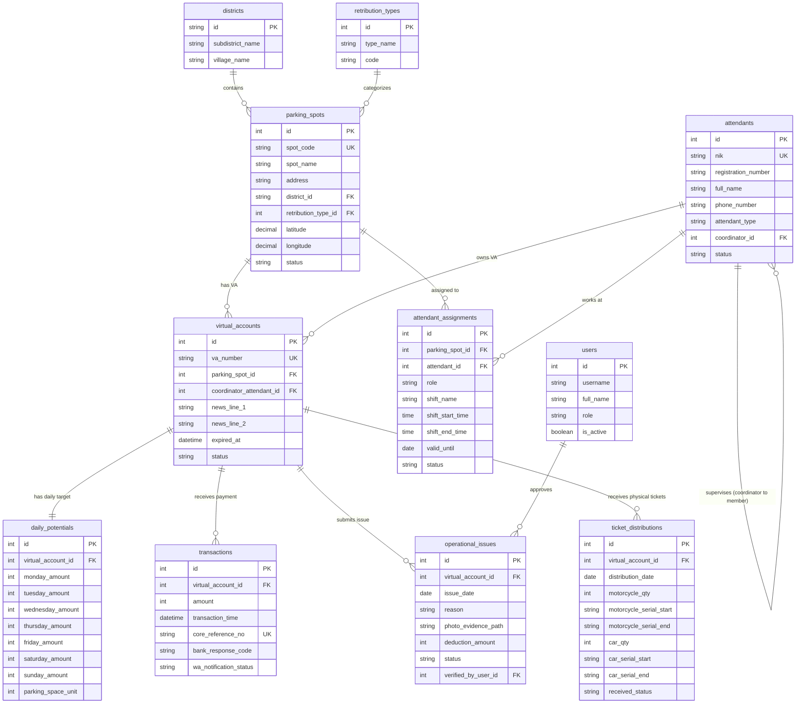

# 09. ENTITY RELATIONSHIP DIAGRAM (ERD)

Diagram relasi entitas konseptual dan relasional untuk arsitektur database baru (*Proposed Clean Schema*).

---

## 9.1 ERD Konseptual (Mermaid Format)

---

## 9.2 Penjelasan Kardinalitas & Integritas Relasi

1. **`districts` (1) ── (N) `parking_spots`**:
   - Satu kelurahan menaungi banyak titik lokasi parkir. Titik parkir merujuk ke kelurahan induk untuk agregasi laporan target per kecamatan.
2. **`attendants` (1) ── (N) `attendants` (Self-Referencing)**:
   - Seorang koordinator parkir membawahi beberapa anggota jukir lapangan.
3. **`parking_spots` (N) ── (N) `attendants` via `attendant_assignments`**:
   - Satu titik parkir dapat dijaga oleh beberapa jukir dengan shift waktu berbeda (Pagi/Sore).
   - Seorang jukir dapat ditugaskan pada titik parkir tertentu dengan masa berlaku SK penugasan.
4. **`virtual_accounts` (1) ── (1) `daily_potentials`**:
   - Setiap nomor Virtual Account memiliki 1 konfigurasi target potensi 7 hari (Senin s/d Minggu).
5. **`virtual_accounts` (1) ── (N) `transactions`**:
   - Satu nomor Virtual Account menerima banyak mutasi setoran harian dari koordinator jukir.
6. **`virtual_accounts` (1) ── (N) `operational_issues`**:
   - Koordinator pemegang VA dapat mengajukan kendala operasional (hujan, penutupan jalan) pada tanggal tertentu untuk meminta dispensasi potongan tagihan harian.

---

## 9.3 Deviasi Cardinalitas Aktual (Setelah Migrasi, 15-Sep)

Setelah migrasi riil ke `dishub_recreate`, beberapa kardinalitas pada blueprint dilonggarkan untuk menampung data sumber — terverifikasi di database:

| Relasi | Blueprint asli | Keadaan setelah migrasi | Alasan |
| :--- | :--- | :--- | :--- |
| `virtual_accounts.parking_spot_id` | 1:N wajib | **nullable** (1 titik tanpa VA) | — |
| `virtual_accounts.coordinator_attendant_id` | 1:N wajib | **nullable** (145 VA tanpa koordinator) | koordinator tidak selalu terisi |
| `transactions.virtual_account_id` | wajib | **nullable** (79 transaksi orphan) | VA rujukan tidak ikut migrasi |
| `transactions.core_reference_no` | UNIQUE (idempotensi) | **bukan UNIQUE** (data duplikat) | retry bank yang sama |
| `operational_issues.photo_evidence_path` | wajib | **nullable** | 4,699 kendala tanpa foto |
| `parking_spots.district_id` | FK ketat | diset NULL jika invalid | 2 kode distrik tidak ada |

Diagram ERD konseptual tetap berlaku untuk desain logis; deviasi ini hanya memengaruhi integritas fisik data yang ter-migrasi.
